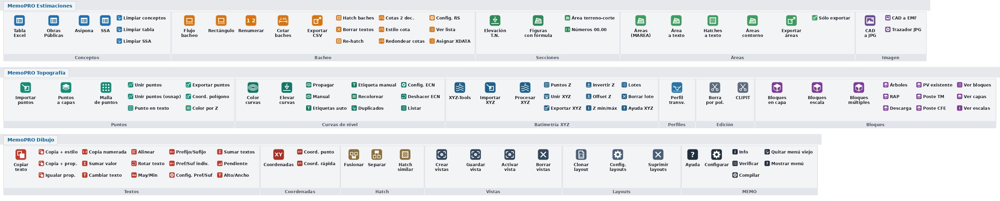

# MEMO SISTEMA: análisis de los LISP y propuestas de mejora

Revisé los 60 archivos LISP, el `Memo.cuix`, el `acad.pgp` y el `perfil_dialog.dcl` del ZIP `MEMO_SISTEMA`.

## 1. Resumen

| | Antes | Ahora (MEMO_SISTEMA.bundle 2.0) |
|---|---|---|
| Instalación | 58 rutas fijas a `C:\Program Files\Autodesk\AutoCAD 2024\…` y `…2026\…` dentro del CUIX; 10 de esas rutas ya no existen | Se copia **una carpeta** (o se ejecuta `INSTALAR.bat`) y funciona en cualquier versión de AutoCAD (2015 a 2026), sin `APPLOAD` ni `CUILOAD` |
| Carga | Se cargan todos los archivos al abrir **cada** dibujo | **Un solo cargador**: cada archivo se carga la primera vez que se usa su comando |
| Menú | Menú desplegable de texto, sin iconos, 7 botones que llaman a comandos que no existen | **3 fichas** en la cinta (Estimaciones, Topografía, Dibujo), 17 paneles y 124 botones con icono y descripción, más el menú desplegable `MEMO` con 143 comandos |
| Conflictos | 11 comandos y 10 funciones internas definidos en varios archivos con código distinto | 0 conflictos (el script de construcción los revisa) |
| Archivos | 60 `.lsp` con espacios y paréntesis en el nombre, con codificaciones mezcladas | 54 `.lsp` con nombres limpios en 10 carpetas, todos en ANSI (Windows-1252) con fin de línea de Windows; 7 obsoletos o duplicados se dejaron fuera |
| Tablas COP/ASI/CSSA | Había que pegar con Ctrl+V y Enter 2 veces | **Leen el portapapeles directamente** |
| Atajos del acad.pgp | 10 comandos LISP anulaban alias tuyos (MP dejaba de ser EMPALME) | Renombrados; tus alias vuelven a funcionar |

---

## 2. Problemas encontrados (del más grave al más leve)

### 2.1 La instalación actual está rota a medias

`Memo.cuix → LSPFiles` carga los LISP con rutas absolutas. Hay tres problemas:

* **Mezcla de versiones**: 47 rutas apuntan a `AutoCAD 2024\Support\…` y 11 a `AutoCAD 2026\Support\…`. En un equipo que sólo tiene una de las dos versiones, parte del sistema no carga.
* **10 rutas ya no existen**, porque los archivos se cambiaron de carpeta:
  * `LISP_Topografia/Insetar Bloques Multiples ( IBM ).lsp`, `…( IBC ).lsp` y `…( IBCZ ).lsp`. Ahora están en `LISP_Bloques`.
  * `LISP_Secciones/Crear Hatch Similar ( CHS )`, `Fusionar Hatch ( FH )` y `SeparaHatch ( SPH )`. Ahora están en `LISP_Hatch`.
  * `LISP_Secciones/Comp_Area_Secc ( CAS )`. Ahora está en `LISP_Estimaciones`.
  * `LISP_Estimaciones/RectanguloSnap.lsp`. El archivo se llama `RectanguloSnap ( RS ).lsp`.
  * `LISP_Topografia/ICE-Z.lsp` y `CLIPIT-Z.lsp`. Ya no existen.
* **Hay archivos que el CUIX no carga**: `XYZ-Tools ( IXYZ )`, `ColorearPorElevacion`, `Procesa-XYZ`, `HAEA` y los del punto anterior.

**Consecuencia:** desde el menú fallan (o funcionan sólo si se cargaron a mano con APPLOAD) **RS, CAS, IBM, IBC, IBCZ, CHS, FH, SPH, IXYZ, PZ, XYZU, P-Z y CPEC**.

### 2.2 Botones del menú que llaman a comandos que no existen

| Botón | Macro | Problema |
|---|---|---|
| Conceptos Excel Acad ( TE ) | `^C^CTE` | Ningún LISP define `TE` |
| Curvas_Nivel ( CCNB ) | `^C^CCCNB` | No existe; los comandos son `CCN` y `CCNT` |
| CLIPIT-Z | `^C^CCLIPITZ` | El archivo ya no existe |
| ICE-Z | `^C^CICEZ` | El archivo ya no existe |
| Exportar datos a CSV ( EXREC ) / ExportaRectangulos | `^C^CEXREC` | Ahora se llama `EXR` |
| RenumerarRectangulos | `^C^CRENUMERAR` | Ahora se llama `RV` / `RENUMERARVECINO` |
| CFGLAYOUTS | `^C^CCFGLAYOUTS` | Ahora se llama `CFTL` |
| **Restaurar Vistas ( RV )** | `^C^CRV` | **`RV` ahora es *Renumerar rectángulos***: el botón de vistas renumera baches. Restaurar vistas es `AV` |

También hay macros repetidas (Importa-XYZ ×4, Procesa-XYZ ×4, ICE ×3).

### 2.3 Funciones internas con el mismo nombre en varios archivos (el error más difícil de detectar)

En AutoLISP todas las funciones son globales. Si dos archivos definen `split-string` con código distinto, **gana el último que se cargó**, y el otro comando usa una función que no es la suya sin dar ningún aviso.

| Función | Archivos que la definen (con código **distinto**) |
|---|---|
| `crearEstilosTexto` | ASI, COP, CSSA (3 versiones) |
| `insertarEncabezadoConOffset`, `crear-rectangulo-encabezados` | ASI, COP |
| `split-string`, `split-string-multiple` | ASI, COP, CSSA, BV, SL |
| `esNumero`, `limpiarTexto`, `esPosibleCodigoConEspacio` | ASI, COP |
| `procesar-seleccion` | BV, SL |

Con el orden de carga del CUIX actual (ASI → COP → CSSA, BV → SL):
* **ASI** termina usando los encabezados de **COP** y los estilos de texto de **CSSA**.
* **BV (Borrar vistas)** usa el `procesar-seleccion` de **SL (Suprimir layouts)**.

Si alguna vez una tabla ASI salió con anchos o estilos raros, esta es la causa más probable.

**Corrección aplicada:** las funciones internas de esos 5 archivos se renombraron con prefijo (`asi:`, `cop:`, `cssa:`, `bv:`, `sl:`), así cada comando usa sólo su propio código.

### 2.4 Comandos definidos en varios archivos

| Comando | Dónde | Comentario |
|---|---|---|
| `HA` | `Area Pref Guard`, `Area Pref Nuevo`, `Exp_Est-Area (EA)`, `HAEA` | 3 implementaciones distintas: según qué se cargue al final, `HA` hace cosas diferentes |
| `HA2`, `HAPREF`, `HARESET`, `HAINFO` | `Area Pref Guard` y `Area Pref Nuevo` | Los dos archivos son **idénticos byte a byte** |
| `EA`, `HAEA` | `Exp_Est-Area` (v7.0) y `HAEA` (v5.2) | Versión vieja y versión nueva |
| `PZ` | `XYZ-Tools` 2.6.2 y `Procesa-XYZ` 8.5 | XYZ-Tools ya incluye PZ y P-Z |
| `FH`, `FUSIONHATCH` | `Fusionar Hatch` y `SeparaHatch` | SPH ya incluye FH |
| `COR`, `COR2` | `Coordenadas_a_texto (COR)` y `(CORM)` | CORM es la versión mejorada |
| `GV` | `Guardar Vistas` y `Restaurar Vistas` | AV ya incluye GV |
| `LIMPIARTABLA` | ASI y COP | Idéntico (no causa problema) |

**Corrección aplicada:** se dejaron fuera los duplicados y las versiones viejas (siguen en `originales/`). El `HA` de EA se renombró a **`EA-HA`**, para que `HA` sea siempre el de “Área + prefijo”.

### 2.5 Manejadores de error que afectan a TODO AutoCAD

* **`Borra_pol ( BPOL )`** define `*error*` **al cargarse**, fuera del comando. Desde ese momento, *cualquier* error o un `ESC` en *cualquier* rutina ejecuta `UCS Previo`, `DESHACER Fin` y hace `setvar` con valores `nil`, lo que provoca un error dentro del error. Además, BPOL nunca activaba su propio manejador.
  **Corrección aplicada:** ahora se llama `bpol:*error*` y sólo se activa mientras corre BPOL.
* **`HAEA.lsp`** reemplaza el `*error*` global de AutoCAD al cargar (`(setq *error* *error-global*)`). Quedó excluido porque EA v7.0 lo sustituye.
* `Coordenadas_a_texto ( COR )` (versión vieja) redefinía `*error*` sin declararlo local ni restaurarlo. También quedó excluido.

### 2.6 Efectos secundarios al cargar

Como todo se cargaba al abrir cada dibujo:
* **RS** crea los estilos de texto `ARIAL` y `MONOTXT4` en **todos** los dibujos que abres, aunque no uses RS.
* **RS, EXR y RV** reinician la variable compartida `*rectangulos-lista*` al cargarse. Si se recarga uno, se pierde la lista de baches en memoria.
* **PS** borra el último prefijo/sufijo usado.
* **ICE** guarda el espacio modelo en variables globales (`AcadObj`, `mspace`) en el momento de cargar.
* Unos 30 archivos imprimen recuadros de bienvenida: la línea de comandos se llena de texto en cada dibujo y el arranque es más lento.

Con la carga bajo demanda, nada de esto pasa hasta que realmente usas el comando.

### 2.7 Conflictos con tu `acad.pgp` (resuelto en 2.1)

Estos comandos LISP tienen el mismo nombre que un alias de tu `acad.pgp`. El comando LISP tiene prioridad, así que **el alias deja de funcionar**:

| Comando LISP | Alias en tu acad.pgp |
|---|---|
| `MP` (malla de puntos) | **EMPALME** (fillet) |
| `EL` (elevación T.N.) | ELIPSE |
| `RV` (renumerar rectángulos) | REVOLUCION |
| `PV` (bloque PV existente) | PTOVISTA |
| `TM` (bloque poste TM) | TILEMODE |
| `CC` (cotas de RS) | CERRARCINTA |
| `CL` (clonar layout) | LINEACENTRO |
| `LC` (limpiar conceptos) | LINEACENTRO |
| `CT` (CT-Toolbox) | TXTC / CTABLESTYLE |
| `CTT` (cambia texto) | ADMATRB |

El caso más delicado es **`MP`**: mientras el sistema esté cargado, **`MP` ya no hace EMPALME**. Esto también pasaba con el menú anterior. Como `MALLA-PUNTOS` también se puede llamar con `MLL`, lo más simple es quitar el alias `MP` de la malla.

Hay que decidir cuál quieres conservar en cada caso. Lo recomendable es renombrar los comandos LISP de 2 letras que chocan (por ejemplo `CC → RSCOTA`, `PV/TM/CFE → IBPV/IBTM/IBCFE`).

### 2.8 Errores puntuales

* **Procesa-XYZ**: busca `Procesa-XYZ.lsp`, pero el archivo se llama `Procesa-XYZ  ( PZ ).lsp`. Además arma la ruta del DCL sin la `\` (`(strcat dir "Procesa-XYZ.dcl")`) y ese `.dcl` no venía en el ZIP. **No podía abrir su diálogo.** (Excluido: lo sustituye XYZ-Tools.)
* **HatchRectangulos** dice “Escribe HATCHRECTANGULOS”, pero el comando es `HR`. *(Corregido.)*
* **Exportar_Coord_POL** dice “ejecutar EXPORCOOR”, pero el comando es `X-Y`.
* **X-Y** y **PERFIL** abren el cuadro de “Guardar” en `C:/`. *(Corregido: ahora abren en la carpeta del dibujo.)*
* **CTF** pone `REGENMODE = 0` y no tiene `*error*`: si cancelas con ESC, se queda en 0.
* **perfil_dialog.dcl** no se usa: PERFIL genera su propio DCL temporal.
* El nombre `Elevaci#U00f3n_Curvas_Nivel` venía dañado por la codificación del ZIP.
* **Codificación mixta**: la mayoría de los archivos está en ANSI (Latin-1), pero `COR`, `EXR` y `perfil_transversal` están en UTF-8. En AutoCAD 2021+ con `LISPSYS=1`, los acentos de los mensajes pueden salir mal en unos u otros.

---

## 3. Lo que se implementó

### 3.1 Instalación en un paso (Autoloader de AutoCAD)

```
MEMO_SISTEMA.bundle/
├── PackageContents.xml          ← AutoCAD lo lee solo al arrancar
└── Contents/
    ├── MEMO_Cargador.lsp        ← ÚNICO cargador
    ├── MEMO_SISTEMA.cuix        ← 3 fichas + menú desplegable
    ├── MEMO_SISTEMA.mnl         ← respaldo: se carga junto con el CUIX
    ├── Iconos/                  ← 284 PNG (16 y 32 px)
    └── LISP/
        ├── Estimaciones/  Bacheo/  Secciones/  Textos/  Hatch/
        └── VistasLayout/  Topografia/  Batimetria/  Bloques/
```

* Basta con copiar la carpeta a `C:\Program Files\Autodesk\ApplicationPlugins\` (o ejecutar `INSTALAR.bat`). AutoCAD la detecta, agrega las rutas de soporte, carga el menú y el cargador. Funciona con **cualquier versión** de AutoCAD desde la 2015, incluidos Civil 3D y Map, sin `APPLOAD`, sin “Conjunto de inicio” y sin `CUILOAD`.
* Para actualizar, se reemplaza la carpeta. Para desinstalar, se borra (`DESINSTALAR.bat`).

### 3.2 Carga bajo demanda

`MEMO_Cargador.lsp` define los 142 comandos como “esqueletos”. La primera vez que escribes `COP`, el cargador carga `COP_ConceptosObrasPublicas.lsp` y ejecuta el comando; las siguientes veces ya va directo. Así:
* El dibujo abre igual de rápido que sin el sistema.
* Un archivo con error no impide que los demás funcionen.
* Los archivos no se pisan entre sí, porque normalmente sólo se cargan los que usas.
* Si algún día compilas un archivo a `.fas` o `.vlx` con el mismo nombre, el cargador usa la versión compilada automáticamente.

Comandos propios del sistema:
* `MEMO_AYUDA`: lista todos los comandos por ficha y panel.
* `MEMO_INFO`: muestra la versión, la carpeta y qué archivos están cargados en el dibujo.
* `MEMO_QUITAR_ANTERIOR`: descarga el `Memo.cuix` viejo. Úsalo **una vez** después de instalar.

### 3.3 Menú con fichas e iconos



*(La imagen es una aproximación: en AutoCAD los paneles se compactan solos si la ventana es angosta.)*

* **MEMO Estimaciones**: Conceptos · Bacheo · Secciones · Áreas · Imagen
* **MEMO Topografía**: Puntos · Curvas de nivel · Batimetría XYZ · Perfiles · Edición · Bloques
* **MEMO Dibujo**: Textos · Coordenadas · Hatch · Vistas · Layouts · MEMO

Cada botón tiene un icono con el color de su categoría y un glifo de la acción (tabla, cota, hatch, exportar, curvas…). Al pasar el cursor encima se ve la descripción del comando. Con `MENUBAR=1` también aparece el menú desplegable **MEMO** con todos los comandos.

### 3.4 Una sola fuente de verdad

Todo (cargador, CUIX, iconos, ayuda y vista previa) se genera desde `herramientas/catalogo.py` con:

```
python herramientas/construir_bundle.py
```

El script también **verifica** que:
* Dos archivos no definan el mismo comando.
* Cada botón del menú apunte a un comando que existe (así no pueden volver a aparecer botones rotos como `TE` o `EXREC`).
* Todos los archivos tengan los paréntesis balanceados.
* Todo el XML del CUIX sea válido.

Para **agregar un LISP nuevo**:
1. Copia el archivo a `originales/MEMO_SISTEMA/<carpeta>/`.
2. Agrega una línea en `ARCHIVOS` (catalogo.py).
3. Describe sus comandos en `COMANDOS`.
4. Ponlos en `FICHAS`.
5. Ejecuta el script y vuelve a instalar.

Si escribiste un comando nuevo y olvidaste describirlo, el script te avisa.

### 3.5 Archivos excluidos (siguen en `originales/`)

| Archivo | Motivo |
|---|---|
| Area Pref Nuevo ( HA2 ) | Idéntico a Area Pref Guard ( HA ) |
| HAEA.lsp | Superado por EA v7.0; además cambiaba el `*error*` global |
| Fusionar Hatch ( FH ) | Incluido en SeparaHatch ( SPH ) |
| Guardar Vistas ( GV ) | Incluido en Restaurar Vistas ( AV ) |
| Coordenadas_a_texto ( COR ) | Superado por CORM (sólo se pierde `CORA`) |
| Procesa-XYZ ( PZ ) | Superado por XYZ-Tools; además estaba roto (ver 2.8) |
| perfil_dialog.dcl | No se usa |

---

## 4. Propuestas de mejora (implementadas en la versión 2.1)

| # | Propuesta | Estado | Cómo quedó |
|---|---|---|---|
| 4.1 | Unificar tablas ASI, COP y CSSA | Hecho (ver nota) | Comando **`MTABLA`** + lectura del **portapapeles** + anchos configurables |
| 4.2 | Unificar la familia de áreas | Hecho | Comando **`MAREA`** |
| 4.3 | Flujo único de bacheo | Hecho | Comando **`MBACHEO`** + espesor configurable |
| 4.4 | Biblioteca común | Hecho | `Sistema/MEMO_Lib.lsp` (prefijo `memo:`) |
| 4.5 | Configuración en un solo lugar | Hecho | Comando **`MEMO_CONFIG`** (17 valores) |
| 4.6 | Resolver choques con el acad.pgp | Hecho | 9 comandos renombrados y `MP` eliminado |
| 4.7 | Compilar | Hecho | Comando **`MEMO_COMPILAR`** |
| 4.8 | Una sola codificación | Hecho | Todo en ANSI (Windows-1252) |
| 4.9 | Pruebas | Hecho | Comando **`MEMO_VERIFICAR`** + [LISTA_DE_PRUEBAS.md](LISTA_DE_PRUEBAS.md) |

### 4.1 Tablas: `MTABLA` y portapapeles
* **COP, ASI y CSSA leen el portapapeles.** Copias las filas en Excel, ejecutas `COP` y eliges el punto. El comando muestra cuántas filas y columnas encontró, enseña la primera fila y pregunta *¿Usar los datos del portapapeles? [Si/No] <Si>*: con Enter se usan.
  * Si el portapapeles está vacío o respondes *No*, puedes pegar a mano como antes.
  * Las celdas de Excel con saltos de línea internos, que Excel copia entre comillas, se unen en una sola línea.
  * Con `MEMO_CONFIG` → *Tablas: usar portapapeles* puedes elegir `SI` (sin preguntar), `NO` (como antes) o `PREGUNTAR` (el valor por defecto).
* **`MTABLA`** es la entrada única. Lee el portapapeles, propone el formato según el número de columnas (5 → Obras Públicas, 7 → Asipona, 4 → SSA) y ejecuta el comando correspondiente sin volver a preguntar.
* **Los anchos de columna** de COP (5), ASI (7) y CSSA (ancho total) se cambian en `MEMO_CONFIG`, sin tocar el código.
* **Nota:** el dibujo de cada formato (posiciones, desplazamientos, `$`, código en dos líneas, totales, recuadros, vistas) **sigue siendo el de tus rutinas originales**. Reescribir los tres motores en uno solo sin poder compararlos dentro de AutoCAD arriesgaría cambiar tablas que ya entregas. Cuando confirmes con la lista de pruebas que todo sale igual, el siguiente paso es convertir cada formato en una lista de columnas dentro de un único motor.

### 4.2 Áreas: `MAREA`
Un solo comando con las opciones *Prefijo (HA2), Rapido (HA), M2 (AM2), Hatch (AH), Contorno (AC), Tres puntos (AS), Detalle (CAS), Valores (QA) y Exportar (EA)*. Recuerda la última opción usada, así que en el uso diario basta con `MAREA` + Enter. Los comandos cortos siguen funcionando igual.

### 4.3 Bacheo: `MBACHEO`
Flujo guiado: *Dibujar (RS) → Numerar (RNB) → Cotar (COTB) → Exportar (EXR)*, con *Hatch, Limpiar y Config* disponibles en cualquier momento. Después de cada paso propone el siguiente, así que normalmente sólo presionas Enter.
* El **espesor** que usa EXR para calcular el volumen (antes 0.10 fijo en el código) ahora es configurable.
* Sobre el XDATA: al revisar el código confirmé que **EXR ya reconstruye la lista desde el XDATA** de los rectángulos que seleccionas. La lista en memoria sólo funciona como caché, así que no hizo falta cambiar la lógica.

### 4.4 Biblioteca común `MEMO_Lib.lsp`
Se carga al abrir cada dibujo (es pequeña) y la usan el código nuevo y la entrada de datos de las tablas:
* **Configuración:** `memo:cfg`, `memo:cfg-num`, `memo:cfg-set`.
* **Portapapeles:** `memo:portapapeles`. Usa el objeto COM `htmlfile` y, si no existe en el equipo, PowerShell.
* **Texto de Excel:** `memo:tsv-normalizar` y `memo:leer-datos-tabla`.
* **Utilidades:** `memo:split`, `memo:opcion`, `memo:llamar`, `memo:recortar`.

Las funciones repetidas *dentro* de las rutinas antiguas (`split-string`, etc.) se quedaron en cada archivo con su prefijo (`asi:`, `cop:`…) para no tocar lógica que ya funciona. Todo comando nuevo debe usar la biblioteca.

### 4.5 `MEMO_CONFIG`
Muestra una lista numerada con el valor actual de cada opción y el valor por defecto cuando lo cambiaste. Escribes el número, el valor nuevo y listo; con `R` se restablece todo.
* Los valores se guardan en tu perfil de AutoCAD (registro de Windows), así que **no se pierden al actualizar o reinstalar** el sistema.
* Los números se validan, y las opciones sólo aceptan los valores permitidos.

### 4.6 Comandos renombrados

| Antes | Ahora | Tu alias que vuelve a funcionar |
|---|---|---|
| `MP` (malla) | *(eliminado, usa `MLL` o `MALLA-PUNTOS`)* | EMPALME |
| `EL` (elevación T.N.) | **`ELTN`** | ELIPSE |
| `RV` (renumerar rectángulos) | **`RNB`** (también `RENUMERARVECINO`) | REVOLUCION |
| `CC` (cotas de RS) | **`RSC`** | CERRARCINTA |
| `PV` (bloque PV) | **`IBPV`** | PTOVISTA |
| `TM` (bloque poste TM) | **`IBTM`** | TILEMODE |
| `CL` (clonar layout) | **`CLO`** | LINEACENTRO |
| `LC` (limpiar conceptos) | **`LCO`** | LINEACENTRO |
| `CT` (CT-Toolbox) | **`CTB`** | TXTC / CTABLESTYLE |
| `CTT` (cambia texto) | **`CTX`** | ADMATRB |

Las fichas, `MEMO_AYUDA` y los mensajes de carga ya usan los nombres nuevos. Ninguno de los nombres nuevos aparece en tu `acad.pgp`.

### 4.7 `MEMO_COMPILAR`
Compila los 56 archivos (incluida la biblioteca) a `.fas` en `%APPDATA%\MEMO_SISTEMA\FAS`. Usa esa carpeta porque `Program Files` no permite escribir sin permisos de administrador.
* Desde el siguiente dibujo, el cargador usa los `.fas`. `MEMO_INFO` indica si están activos.
* Al instalar una **versión nueva** del sistema, los `.fas` viejos se ignoran solos (se comparan por número de versión) hasta que vuelvas a compilar.
* Usa `vlisp-compile` de AutoCAD. Si tu versión no lo trae, el comando lo avisa y todo sigue con los `.lsp`.

### 4.8 Codificación
Todos los `.lsp` del bundle están ahora en **ANSI (Windows-1252)**, la codificación en la que ya estaban casi todos tus archivos y que funcionaba en tu AutoCAD. Los dos que venían en UTF-8 (EXR y PERFIL) se convirtieron; antes podían mostrar acentos raros. Además, todos usan fin de línea de Windows (CRLF).

### 4.9 Pruebas
* **`MEMO_VERIFICAR`**: en un dibujo nuevo, carga los 55 archivos y comprueba que cada uno de los 140+ comandos quede definido. Muestra un resumen con *ERROR AL CARGAR* o *NO DEFINIDO* si algo falla. Tarda segundos y conviene correrlo después de cada actualización.
* **[LISTA_DE_PRUEBAS.md](LISTA_DE_PRUEBAS.md)**: pasos manuales cortos por comando para comparar contra el comportamiento anterior, empezando por lo que cambió en 2.1. Puedes usar `Ejercicio COMANDOS NUEVOS.dwg`.

### 4.10 Lo que sigue (cuando confirmes las pruebas)
1. Un solo motor de tablas basado en listas de columnas, sustituyendo los tres motores actuales.
2. Pasar las alturas de texto y los nombres de capas de cada rutina a `MEMO_CONFIG`.
3. Mover a la biblioteca las funciones repetidas de las rutinas antiguas, una por una y probando cada cambio.

## 4b. Mejoras de la versión 2.2

Revisé los ~140 comandos buscando problemas comunes. Encontré dos que afectan a casi todos:

| Problema | Cuántos | Efecto |
|---|---|---|
| No agrupan el Deshacer | 95 comandos | Después de una tabla COP, `U` borraba texto por texto en lugar de toda la tabla |
| Cambian variables sin manejador de errores | 20 comandos (COP, ASI, CV, COTB, CHS, CTF, IJPG-EMF, los bloques IBCZ...) | Con ESC a la mitad quedaban OSMODE=0, otra capa activa, REGENMODE=0, etc. |

**Solución única para todos:** cuando el cargador carga un archivo, "envuelve" cada uno de sus comandos (`memo:ejecutar` en MEMO_Lib):
* Todo lo que hace el comando queda en **un solo paso de Deshacer**.
* Si se cancela o falla, se restauran OSMODE, CLAYER, TEXTSTYLE, CMDECHO, SNAPMODE/SNAPUNIT, ORTHOMODE, REGENMODE, CECOLOR, FILEDIA, CMDDIA, DIMZIN, HIGHLIGHT, UCSFOLLOW, PDMODE/PDSIZE y HPNAME/HPSCALE/HPANG.
* Si el comando termina bien, **no se toca nada**: lo que el comando cambió a propósito (por ejemplo PDMODE en la malla) se queda.
* Los comandos que llaman a otros (MTABLA → COP, FH → FUSIONHATCH) usan un solo grupo de Deshacer.
* Si un comando tiene su propio manejador de errores, se respeta. Si eso deja el grupo de Deshacer abierto, se cierra al empezar el siguiente comando MEMO.
* Si algún comando se portara raro, en `MEMO_CONFIG` → *Un solo Deshacer...* = `NO` todo vuelve al comportamiento anterior.

**COP / ASI / CSSA:** por defecto (`TABLA_PORTAPAPELES = SI`) usan lo copiado sin preguntar. Sólo preguntan si el número de columnas no coincide (5 / 7 / 4), para no dibujar una tabla descuadrada.

**CTX:** si tienes copiada una sola línea de texto, se ofrece como valor por defecto.

**Mensajes de carga corregidos:** X-Y (decía EXPORCOOR), BV (LVA), GV (AG), CLO (ClonLayout), SL (EliminarLayouts/EL), CLIPIT (CLIPIMAGE_RECT), COP (COP5), AM2 (anunciaba un HA3 que no existe) y CTX (decía CTE).

## 4c. Malla de puntos (versión 2.3)

**Problema reportado:** la malla no rellenaba bien entre las curvas de nivel.

**Causa** (MALLA-PUNTOS v4.7): cada punto promediaba con IDW (peso 1/d²) las curvas cuyo rectángulo envolvente, ampliado 10 m, contenía el punto. Esto provocaba:
1. **Escalones:** la curva más cercana dominaba el promedio. Entre 100 y 101 los puntos quedaban en ~100.0x hasta casi la mitad y luego saltaban.
2. **Huecos:** con curvas separadas más de ~20 m, los puntos intermedios no tenían curva "cercana" y no se creaban. En la prueba con curvas cada 30 m quedó vacío el 27 % de la malla.
3. **Contaminación:** curvas largas o cerradas tienen un rectángulo enorme, así que curvas de otros niveles entraban en el promedio.

**Solución** (`fuente/MEMO_MallaInterp.lsp`, se agrega al archivo de la malla al construir):
* Para cada punto se busca la **curva más cercana** (z1, d1) y la **más cercana del otro lado con otra elevación** (z2, d2). Que esté "del otro lado" se comprueba con el producto punto de las direcciones hacia cada curva.
* Se interpola linealmente: **z = z1 + (z2 − z1) · d1 / (d1 + d2)**. En cimas, fondos y bordes, donde no hay curva del otro lado, se usa z1.
* Se mide la distancia a los **segmentos** de las curvas, y un **índice por celdas** evita revisar todas las curvas en cada punto. El radio de búsqueda se calcula solo (3 × la separación típica entre curvas) o se fija en `MEMO_CONFIG`.

**Verificación** (`python herramientas/probar_malla.py`, que ejecuta el AutoLISP real con un intérprete de prueba):

| Terreno | Método nuevo: error medio / máx. | IDW anterior: error medio / máx. | Puntos sin valor (nuevo / anterior) |
|---|---|---|---|
| Cono, curvas cada 10 m | 0.004 / 0.009 m | 0.120 / 0.301 m | 0 / 0 |
| Plano, curvas cada 30 m | 0.000 / 0.000 m | 0.273 / 0.500 m | 0 / **200 de 750** |
| Ladera ondulada | 0.010 / 0.021 m | 0.127 / 0.309 m | 0 / 0 |
| Batimetría (Z negativas) | 0.004 / 0.008 m | 0.123 / 0.292 m | 0 / 0 |

En un terreno de 500 × 500 m con 4,400 vértices, el método nuevo fue además **unas 9 veces más rápido**.

**También corregido:**
* El redondeo de Z negativas: −1.234 daba −1.22.
* Las curvas de elevación 0 se ignoraban siempre; ahora se pueden usar con `MALLA_CURVA_CERO = SI`, útil en batimetría.

## 4d. EA, exportador de áreas (versión 2.4)

Revisé EA v7.0 línea por línea y probé sus funciones con el código real (`herramientas/probar_ea.py`). La versión corregida 7.1 está en `fuente/EA_ExportarEstArea.lsp`, con el registro de cambios en la cabecera; el original quedó intacto en `originales/`.

| # | Error | Efecto | Corrección |
|---|---|---|---|
| 1 | Fórmulas `=SI(`, `PROMEDIO(`, `REDONDEAR(`, `SUMA(` enviadas a Excel por COM | Excel por COM sólo entiende fórmulas en inglés: **#¿NOMBRE? en promedios, volúmenes y totales** | `IF`, `AVERAGE`, `ROUND`, `SUM` |
| 2 | El área se tomaba juntando dígitos de todo el texto, y `"."` en `wcmatch` acepta *cualquier* signo | "SUB-BASE=3.25" → **−3.25**; "(M2)=12.50" → **2.0**; "1,234.56" → **1.0**; "15,5" → **15.0** | Se lee el número **después del último "=" o ":"**; coma de miles o decimal; siempre positivo |
| 3 | No se ignoraban los códigos de formato de MTEXT | `\H0.25x;…=7.80` → **0.25**; al etiquetar se escribía el área **dentro** del código de formato | Se quitan los códigos de formato al leer y se saltan al reemplazar |
| 4 | El cadenamiento juntaba todos los dígitos antes del "+" | "SECCION 3 KM 1+020" → **31020** | Sólo los dígitos pegados al "+" |
| 5 | Un CAD escrito dos veces se buscaba por nombre | Las áreas se **duplicaban** en dos filas | Una fila por CAD |
| 6 | Las casillas "Tipo de Áreas a Procesar" se guardaban pero no se usaban | Desmarcar un tipo no hacía nada | Filtran el etiquetado y la exportación |
| 7 | Las listas de capas y textos a ignorar estaban definidas pero no se usaban | Textos "AREA" del membrete entraban al Excel | Se ignoran textos en capas MEMBRETE, TITULOS, NOTAS, ESCALA, etc. |
| 8 | "Exportar" con "Seleccionar secciones" no pedía selección | Usaba una selección vieja o todo el dibujo | Pide la ventana de selección |
| 9 | `rtos` depende de DIMZIN | El área podía escribirse "12.5" o "12.50" según el dibujo | Decimales fijos (`EA_DECIMALES`) |
| 10 | Distancia máxima texto–hatch fija en 50 | No se podía ajustar | `EA_DISTANCIA_MAX` en `MEMO_CONFIG` |

También: variables que se filtraban a globales y números del Excel con formato `0.00`.

## 4e. Versión 2.5: menú y mejoras de EA

### Menú que no cargaba
En el registro de AutoCAD se veían los LISP del bundle cargados, pero **MEMO_SISTEMA** no aparecía entre los grupos de personalización. Lo comparé con el generador de CUIX de Autodesk Developer Network (`ADN-DevTech/acad-cuix-builder`) y con un `RibbonRoot.cui` extraído de un CUIX real:
1. En `PackageContents.xml`, la línea del CUIX necesita **`LoadOnAutoCADStartup="True"`**. Sin eso AutoCAD registra el componente pero no lo carga. Es la causa más probable.
2. La cinta ahora usa el formato exacto que guarda AutoCAD:
   * `<RibbonRoot>` sin namespace (va en `RibbonPanelSourceCollection`).
   * `Id="AcRibbonCommandButton"`, `TooltipTitle` y `ModifiedRev` en cada elemento.
   * `RibbonRowPanel` con `ResizeStyle`, `RibbonPanelBreak` y `ResizeStyle="Default"` en las referencias.
3. Los UID tienen el formato de AutoCAD (`RBNU_900_XXXXX`).
4. Los iconos son BMP de 24 bits incrustados con relaciones `Image`.

Si con todo esto AutoCAD rechazara el archivo, `MEMO_MENU` muestra el error y crea el menú desplegable MEMO por ActiveX, sin depender del CUIX.

### EA 7.2
1. **Recuadro de sección:** antes, cada texto de área iba al CAD más cercano. Con secciones apiladas y juntas, un texto pegado al borde podía quedar más cerca del CAD de la sección vecina. Ahora se busca la polilínea cerrada más pequeña que contenga al texto y a algún CAD, y se usa el CAD de ese recuadro. Al etiquetar, sólo se buscan hatches dentro del mismo recuadro. Si no hay recuadros, todo funciona como antes. Se configura con `EA_ASIGNACION` (RECUADRO/CERCANO) y `EA_CAPA_RECUADRO`.
2. **Hoja RESUMEN** en el Excel, con fórmulas que leen la hoja VOLUMEN:

   | Columna | Contenido |
   |---|---|
   | VOL. CORTE | Suma de los tipos de corte |
   | CORTE x COEF. | Corte × coeficiente de abundamiento (celda D2, editable) |
   | VOL. RELLENO | Suma de los tipos de relleno |
   | DIFERENCIA | Corte con coeficiente − relleno |
   | CURVA MASA | Diferencia acumulada (ordenadas de la curva masa) |

   Se completa con totales y una tabla de volumen por tipo. Qué tipos son corte y cuáles relleno se define en `MEMO_CONFIG`.
3. **Tipos:** se agregan **SUBBASE, TERRAPLEN y DESMONTE**, con su casilla en el cuadro de EA.
   * Texto y capa se clasifican con el mismo patrón y por prioridad: SUBBASE va antes que BASE, así que una capa "SUBBASE" ya no se cuenta como BASE.
   * Cada patrón es configurable (`EA_TIPO_<TIPO>`). Ejemplo: `*BASE*,*BAS-*`.

Verificado con `herramientas/probar_ea.py` (35 casos, incluido un texto que el método anterior mandaba al CAD equivocado).

## 5. Tabla de equivalencias de archivos

| Original | Nuevo (Contents/LISP/…) | Comandos |
|---|---|---|
| LISP_Estimaciones/Conceptos Obras Publicas ( COP ) | Estimaciones/COP_ConceptosObrasPublicas | COP, LIMPIARTABLA |
| LISP_Estimaciones/Conceptos Asipona ( ASI ) | Estimaciones/ASI_ConceptosAsipona | ASI |
| LISP_Estimaciones/Conceptos SSA ( CSSA ) | Estimaciones/CSSA_ConceptosSSA | CSSA, LIMPIARCSSA |
| LISP_Estimaciones/Limpiar Conceptos ( LC ) | Estimaciones/LC_LimpiarConceptos | **LCO** (antes LC) |
| LISP_Estimaciones/Comp_Area_Secc ( CAS ) | Estimaciones/CAS_CompAreaSecc | CAS, QA |
| LISP_Estimaciones/CAD a JPG ( IJPG ) | Estimaciones/IJPG_CadAJpg | IJPG, IJPG-EMF, IJPG-PC3 |
| LISP_Estimaciones/RectanguloSnap ( RS ) | Bacheo/RS_RectanguloSnap | RS, **RSC** (antes CC), AEC, RC2, RSHATCH, RS-CONFIG |
| LISP_Estimaciones/RenumerarRectangulos ( RV ) | Bacheo/RV_RenumerarRectangulos | **RNB** (antes RV), RENUMERARVECINO |
| LISP_Estimaciones/COTAR_BACHES (COTB ) | Bacheo/COTB_CotarBaches | COTB |
| LISP_Estimaciones/ExportaRectangulos ( EXR ) | Bacheo/EXR_ExportaRectangulos | EXR, VERLISTA, VERXDATA, AXD |
| LISP_Estimaciones/HatchRectangulos | Bacheo/HR_HatchRectangulos | HR |
| LISP_Estimaciones/BorrarTextoEnRect | Bacheo/BTR_BorrarTextoEnRect | BTR |
| LISP_Secciones/Elevacion ( EL ) | Secciones/EL_Elevacion | **ELTN** (antes EL) |
| LISP_Secciones/Cambia Numeros x 00.00 ( R00 ) | Secciones/R00_CambiaNumeros | R00 |
| LISP_Secciones/Area_m2 ( AM2 ) | Secciones/AM2_AreaM2 | AM2 |
| LISP_Secciones/Area Pref Guard ( HA ) | Secciones/HA_AreaPrefijo | HA, HA2, HAPREF, HARESET, HAINFO |
| LISP_Secciones/Area_Secc 3P( AS ) | Secciones/AS_AreaSecc3P | AS |
| LISP_Secciones/Extraer Area de Cont ( AC ) | Secciones/AC_AreaContorno | AC |
| LISP_Secciones/Extraer Area de Hatch ( AH ) | Secciones/AH_AreaHatch | AH, AH2, AHINFO |
| LISP_Secciones/Exp_Est-Area ( EA ) | Secciones/EA_ExportarEstArea | EA, HAEA, HAEA-EXPORT, **EA-HA** (antes HA) |
| LISP_Textos/CT-Toolbox | Textos/CT_Toolbox | **CTB** (antes CT), CTE, CTP, IPT, CTN, STV |
| LISP_Textos/Cambia Texto ( CTT ) | Textos/CTT_CambiaTexto | **CTX** (antes CTT) |
| LISP_Textos/Alinear Texto ( ALIT ) | Textos/ALIT_AlinearTexto | ALIT |
| LISP_Textos/Pendiente ( PTE ) | Textos/PTE_Pendiente | PTE |
| LISP_Textos/MayMin ( UL ) | Textos/UL_MayMin | UL |
| LISP_Textos/PrefijoSufijo ( PS ) | Textos/PS_PrefijoSufijo | PS, PREFSUFIND, VERPREFSUF, SETPREFSUF, LIMPIARPREFSUF |
| LISP_Textos/Rot-Text ( RTT ) | Textos/RTT_RotarTexto | RTT |
| LISP_Textos/Suma Valores Textos ( ST ) | Textos/ST_SumaTextos | ST |
| LISP_Textos/Texto_Alto_Ancho | Textos/CTAF_TextoAltoAncho | CTAF, CTAF2, CTF |
| LISP_Textos/Coordenadas_a_texto ( CORM ) | Textos/CORM_CoordenadasATexto | COR, COR2, CORM |
| LISP_Hatch/SeparaHatch ( SPH ) | Hatch/SPH_SeparaFusionaHatch | SPH, SEPARAHATCH, FH, FUSIONHATCH |
| LISP_Hatch/Crear Hatch Similar ( CHS ) | Hatch/CHS_HatchSimilar | CHS |
| LISP_VistasLayout/Crear Vistas ( CV ) | VistasLayout/CV_CrearVistas | CV |
| LISP_VistasLayout/Restaurar Vistas ( AV ) | VistasLayout/AV_GuardarRestaurarVistas | AV, GV |
| LISP_VistasLayout/Borrar Vistas ( BV ) | VistasLayout/BV_BorrarVistas | BV |
| LISP_VistasLayout/ClonLayout ( CL ) | VistasLayout/CL_ClonarLayout | **CLO** (antes CL) |
| LISP_VistasLayout/Configurar Layouts ( CFTL ) | VistasLayout/CFTL_ConfigurarLayouts | CFTL |
| LISP_VistasLayout/SuprimirLayouts ( SL ) | VistasLayout/SL_SuprimirLayouts | SL |
| LISP_Topografia/Importar PUNTOS ( ICE ) | Topografia/ICE_ImportarPuntos | ICE |
| LISP_Topografia/Ptos Civil a Capas ( PCC ) | Topografia/PCC_PuntosCivilACapas | PCC |
| LISP_Topografia/UnirPuntosPol ( UPP ) | Topografia/UPP_UnirPuntosPol | UPP, UPPA |
| LISP_Topografia/Malla_PUNTOS ( MALLA ) | Topografia/MP_MallaPuntos | MALLA-PUNTOS, MLL, EXPORTAR-PUNTOS, EXP (MP eliminado) |
| LISP_Topografia/Exportar_Coord_POL ( X-Y ) | Topografia/XY_ExportarCoordPol | X-Y |
| LISP_Topografia/ColorearPorElevacion | Topografia/CPEC_ColorearPorElevacion | CPEC |
| LISP_Topografia/Curvas_Nivel ( CCN ) | Topografia/CCN_CurvasNivel | CCN, CCNT, CCNAYUDA |
| LISP_Topografia/Elevación_Curvas_Nivel ( ECN ) | Topografia/ECN_ElevacionCurvas | ECN, ECN-*, ETM |
| LISP_Topografia/Borra_pol ( BPOL ) | Topografia/BPOL_BorraPol | BPOL |
| LISP_Topografia/CLIPIT | Topografia/CLIPIT | CLIPIT |
| LISP_Batimetria/XYZ-Tools ( IXYZ ) | Batimetria/XYZ_Tools | XYZ, IXYZ, PZ, P-Z, XYZU, EXYZ, IZ, OZ, ZM, XYZLOTES… |
| LISP_NubePuntos/PTO-INS-TEXTO ( PIT ) | Batimetria/PIT_PuntoInsTexto | PIT |
| LISP_NubePuntos/perfil_transversal | Batimetria/PERFIL_Transversal | PERFIL |
| LISP_Bloques/Insertar Bloques en Capa ( IBC ) | Bloques/IBC_BloquesEnCapa | IBC |
| LISP_Bloques/Insertar Bloques en Capa ( IBCZ ) | Bloques/IBCZ_BloquesEnCapaEscala | IBCZ, ARBOLES, RAP, DES, **IBPV**, **IBTM**, CFE, VERBLOQUES, VERCAPAS, CONFIGESCALAS |
| LISP_Bloques/Insetar Bloques Multiples ( IBM ) | Bloques/IBM_BloquesMultiples | IBM |
| *(nuevo)* fuente/MEMO_Unificados | Sistema/MEMO_Unificados | MTABLA, MAREA, MBACHEO, MEMO_CONFIG |
| *(nuevo)* fuente/MEMO_Lib | Sistema/MEMO_Lib | biblioteca (sin comandos) |

---

## 6. Pendiente de verificar en AutoCAD

Todo se generó y se validó fuera de AutoCAD: XML válido, paréntesis balanceados, cero colisiones y comandos de los botones comprobados contra los archivos. **No pude ejecutar AutoCAD en este entorno.** La primera vez:
1. En un dibujo nuevo, ejecuta **`MEMO_VERIFICAR`**: debe decir *Todo correcto*.
2. Sigue la sección **"Lo nuevo en 2.1"** de [LISTA_DE_PRUEBAS.md](LISTA_DE_PRUEBAS.md), sobre todo **COP con el portapapeles**.
3. Si las fichas no aparecen: clic derecho en la cinta → *Mostrar fichas*, o `CUILOAD` → `Contents\MEMO_SISTEMA.cuix`.
