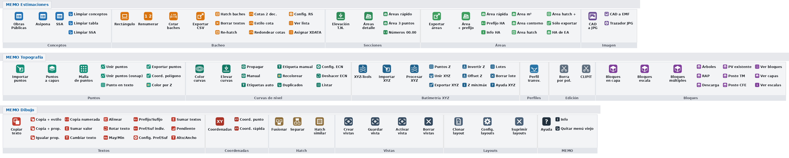

# MEMO SISTEMA: análisis de los LISP y propuestas de mejora

Revisé los 60 archivos LISP, el `Memo.cuix`, el `acad.pgp` y el `perfil_dialog.dcl` del ZIP `MEMO_SISTEMA`.

## 1. Resumen

| | Antes | Ahora (MEMO_SISTEMA.bundle 2.0) |
|---|---|---|
| Instalación | 58 rutas fijas a `C:\Program Files\Autodesk\AutoCAD 2024\…` y `…2026\…` dentro del CUIX; 10 de esas rutas ya no existen | Se copia **una carpeta** (o se ejecuta `INSTALAR.bat`) y funciona en cualquier versión de AutoCAD (2015 a 2026), sin `APPLOAD` ni `CUILOAD` |
| Carga | Se cargan todos los archivos al abrir **cada** dibujo | **Un solo cargador**: cada archivo se carga la primera vez que se usa su comando |
| Menú | Menú desplegable de texto, sin iconos, 7 botones que llaman a comandos que no existen | **3 fichas** en la cinta (Estimaciones, Topografía, Dibujo), 17 paneles y 117 botones con icono y descripción, más el menú desplegable `MEMO` con 138 comandos |
| Conflictos | 11 comandos y 10 funciones internas definidos en varios archivos con código distinto | 0 conflictos (el script de construcción los revisa) |
| Archivos | 60 `.lsp` con espacios y paréntesis en el nombre | 54 `.lsp` con nombres limpios, ordenados en 10 carpetas; 7 obsoletos o duplicados se dejaron fuera |

---

## 2. Problemas encontrados (del más grave al más leve)

### 2.1 La instalación actual está rota a medias

`Memo.cuix → LSPFiles` carga los LISP con rutas absolutas. Hay tres problemas:

* **Mezcla de versiones**: 47 rutas apuntan a `AutoCAD 2024\Support\…` y 11 a `AutoCAD 2026\Support\…`. En un equipo que sólo tiene una de las dos versiones, parte del sistema no carga.
* **10 rutas ya no existen**, porque los archivos se cambiaron de carpeta:
  * `LISP_Topografia/Insetar Bloques Multiples ( IBM ).lsp`, `…( IBC ).lsp` y `…( IBCZ ).lsp`. Ahora están en `LISP_Bloques`.
  * `LISP_Secciones/Crear Hatch Similar ( CHS )`, `Fusionar Hatch ( FH )` y `SeparaHatch ( SPH )`. Ahora están en `LISP_Hatch`.
  * `LISP_Secciones/Comp_Area_Secc ( CAS )`. Ahora está en `LISP_Estimaciones`.
  * `LISP_Estimaciones/RectanguloSnap.lsp`. El archivo se llama `RectanguloSnap ( RS ).lsp`.
  * `LISP_Topografia/ICE-Z.lsp` y `CLIPIT-Z.lsp`. Ya no existen.
* **Hay archivos que el CUIX no carga**: `XYZ-Tools ( IXYZ )`, `ColorearPorElevacion`, `Procesa-XYZ`, `HAEA` y los del punto anterior.

**Consecuencia:** desde el menú fallan (o funcionan sólo si se cargaron a mano con APPLOAD) **RS, CAS, IBM, IBC, IBCZ, CHS, FH, SPH, IXYZ, PZ, XYZU, P-Z y CPEC**.

### 2.2 Botones del menú que llaman a comandos que no existen

| Botón | Macro | Problema |
|---|---|---|
| Conceptos Excel Acad ( TE ) | `^C^CTE` | Ningún LISP define `TE` |
| Curvas_Nivel ( CCNB ) | `^C^CCCNB` | No existe; los comandos son `CCN` y `CCNT` |
| CLIPIT-Z | `^C^CCLIPITZ` | El archivo ya no existe |
| ICE-Z | `^C^CICEZ` | El archivo ya no existe |
| Exportar datos a CSV ( EXREC ) / ExportaRectangulos | `^C^CEXREC` | Ahora se llama `EXR` |
| RenumerarRectangulos | `^C^CRENUMERAR` | Ahora se llama `RV` / `RENUMERARVECINO` |
| CFGLAYOUTS | `^C^CCFGLAYOUTS` | Ahora se llama `CFTL` |
| **Restaurar Vistas ( RV )** | `^C^CRV` | **`RV` ahora es *Renumerar rectángulos***: el botón de vistas renumera baches. Restaurar vistas es `AV` |

También hay macros repetidas (Importa-XYZ ×4, Procesa-XYZ ×4, ICE ×3).

### 2.3 Funciones internas con el mismo nombre en varios archivos (el error más difícil de detectar)

En AutoLISP todas las funciones son globales. Si dos archivos definen `split-string` con código distinto, **gana el último que se cargó**, y el otro comando usa una función que no es la suya sin dar ningún aviso.

| Función | Archivos que la definen (con código **distinto**) |
|---|---|
| `crearEstilosTexto` | ASI, COP, CSSA (3 versiones) |
| `insertarEncabezadoConOffset`, `crear-rectangulo-encabezados` | ASI, COP |
| `split-string`, `split-string-multiple` | ASI, COP, CSSA, BV, SL |
| `esNumero`, `limpiarTexto`, `esPosibleCodigoConEspacio` | ASI, COP |
| `procesar-seleccion` | BV, SL |

Con el orden de carga del CUIX actual (ASI → COP → CSSA, BV → SL):
* **ASI** termina usando los encabezados de **COP** y los estilos de texto de **CSSA**.
* **BV (Borrar vistas)** usa el `procesar-seleccion` de **SL (Suprimir layouts)**.

Si alguna vez una tabla ASI salió con anchos o estilos raros, esta es la causa más probable.

**Corrección aplicada:** las funciones internas de esos 5 archivos se renombraron con prefijo (`asi:`, `cop:`, `cssa:`, `bv:`, `sl:`), así cada comando usa sólo su propio código.

### 2.4 Comandos definidos en varios archivos

| Comando | Dónde | Comentario |
|---|---|---|
| `HA` | `Area Pref Guard`, `Area Pref Nuevo`, `Exp_Est-Area (EA)`, `HAEA` | 3 implementaciones distintas: según qué se cargue al final, `HA` hace cosas diferentes |
| `HA2`, `HAPREF`, `HARESET`, `HAINFO` | `Area Pref Guard` y `Area Pref Nuevo` | Los dos archivos son **idénticos byte a byte** |
| `EA`, `HAEA` | `Exp_Est-Area` (v7.0) y `HAEA` (v5.2) | Versión vieja y versión nueva |
| `PZ` | `XYZ-Tools` 2.6.2 y `Procesa-XYZ` 8.5 | XYZ-Tools ya incluye PZ y P-Z |
| `FH`, `FUSIONHATCH` | `Fusionar Hatch` y `SeparaHatch` | SPH ya incluye FH |
| `COR`, `COR2` | `Coordenadas_a_texto (COR)` y `(CORM)` | CORM es la versión mejorada |
| `GV` | `Guardar Vistas` y `Restaurar Vistas` | AV ya incluye GV |
| `LIMPIARTABLA` | ASI y COP | Idéntico (no causa problema) |

**Corrección aplicada:** se dejaron fuera los duplicados y las versiones viejas (siguen en `originales/`). El `HA` de EA se renombró a **`EA-HA`**, para que `HA` sea siempre el de “Área + prefijo”.

### 2.5 Manejadores de error que afectan a TODO AutoCAD

* **`Borra_pol ( BPOL )`** define `*error*` **al cargarse**, fuera del comando. Desde ese momento, *cualquier* error o un `ESC` en *cualquier* rutina ejecuta `UCS Previo`, `DESHACER Fin` y hace `setvar` con valores `nil`, lo que provoca un error dentro del error. Además, BPOL nunca activaba su propio manejador.
  **Corrección aplicada:** ahora se llama `bpol:*error*` y sólo se activa mientras corre BPOL.
* **`HAEA.lsp`** reemplaza el `*error*` global de AutoCAD al cargar (`(setq *error* *error-global*)`). Quedó excluido porque EA v7.0 lo sustituye.
* `Coordenadas_a_texto ( COR )` (versión vieja) redefinía `*error*` sin declararlo local ni restaurarlo. También quedó excluido.

### 2.6 Efectos secundarios al cargar

Como todo se cargaba al abrir cada dibujo:
* **RS** crea los estilos de texto `ARIAL` y `MONOTXT4` en **todos** los dibujos que abres, aunque no uses RS.
* **RS, EXR y RV** reinician la variable compartida `*rectangulos-lista*` al cargarse. Si se recarga uno, se pierde la lista de baches en memoria.
* **PS** borra el último prefijo/sufijo usado.
* **ICE** guarda el espacio modelo en variables globales (`AcadObj`, `mspace`) en el momento de cargar.
* Unos 30 archivos imprimen recuadros de bienvenida: la línea de comandos se llena de texto en cada dibujo y el arranque es más lento.

Con la carga bajo demanda, nada de esto pasa hasta que realmente usas el comando.

### 2.7 Conflictos con tu `acad.pgp`

Estos comandos LISP tienen el mismo nombre que un alias de tu `acad.pgp`. El comando LISP tiene prioridad, así que **el alias deja de funcionar**:

| Comando LISP | Alias en tu acad.pgp |
|---|---|
| `MP` (malla de puntos) | **EMPALME** (fillet) |
| `EL` (elevación T.N.) | ELIPSE |
| `RV` (renumerar rectángulos) | REVOLUCION |
| `PV` (bloque PV existente) | PTOVISTA |
| `TM` (bloque poste TM) | TILEMODE |
| `CC` (cotas de RS) | CERRARCINTA |
| `CL` (clonar layout) | LINEACENTRO |
| `LC` (limpiar conceptos) | LINEACENTRO |
| `CT` (CT-Toolbox) | TXTC / CTABLESTYLE |
| `CTT` (cambia texto) | ADMATRB |

El caso más delicado es **`MP`**: mientras el sistema esté cargado, **`MP` ya no hace EMPALME**. Esto también pasaba con el menú anterior. Como `MALLA-PUNTOS` también se puede llamar con `MLL`, lo más simple es quitar el alias `MP` de la malla.

Hay que decidir cuál quieres conservar en cada caso. Lo recomendable es renombrar los comandos LISP de 2 letras que chocan (por ejemplo `CC → RSCOTA`, `PV/TM/CFE → IBPV/IBTM/IBCFE`).

### 2.8 Errores puntuales

* **Procesa-XYZ**: busca `Procesa-XYZ.lsp`, pero el archivo se llama `Procesa-XYZ  ( PZ ).lsp`. Además arma la ruta del DCL sin la `\` (`(strcat dir "Procesa-XYZ.dcl")`) y ese `.dcl` no venía en el ZIP. **No podía abrir su diálogo.** (Excluido: lo sustituye XYZ-Tools.)
* **HatchRectangulos** dice “Escribe HATCHRECTANGULOS”, pero el comando es `HR`. *(Corregido.)*
* **Exportar_Coord_POL** dice “ejecutar EXPORCOOR”, pero el comando es `X-Y`.
* **X-Y** y **PERFIL** abren el cuadro de “Guardar” en `C:/`. *(Corregido: ahora abren en la carpeta del dibujo.)*
* **CTF** pone `REGENMODE = 0` y no tiene `*error*`: si cancelas con ESC, se queda en 0.
* **perfil_dialog.dcl** no se usa: PERFIL genera su propio DCL temporal.
* El nombre `Elevaci#U00f3n_Curvas_Nivel` venía dañado por la codificación del ZIP.
* **Codificación mixta**: la mayoría de los archivos está en ANSI (Latin-1), pero `COR`, `EXR` y `perfil_transversal` están en UTF-8. En AutoCAD 2021+ con `LISPSYS=1`, los acentos de los mensajes pueden salir mal en unos u otros.

---

## 3. Lo que se implementó

### 3.1 Instalación en un paso (Autoloader de AutoCAD)

```
MEMO_SISTEMA.bundle/
├── PackageContents.xml          ← AutoCAD lo lee solo al arrancar
└── Contents/
    ├── MEMO_Cargador.lsp        ← ÚNICO cargador
    ├── MEMO_SISTEMA.cuix        ← 3 fichas + menú desplegable
    ├── MEMO_SISTEMA.mnl         ← respaldo: se carga junto con el CUIX
    ├── Iconos/                  ← 284 PNG (16 y 32 px)
    └── LISP/
        ├── Estimaciones/  Bacheo/  Secciones/  Textos/  Hatch/
        └── VistasLayout/  Topografia/  Batimetria/  Bloques/
```

* Basta con copiar la carpeta a `C:\Program Files\Autodesk\ApplicationPlugins\` (o ejecutar `INSTALAR.bat`). AutoCAD la detecta, agrega las rutas de soporte, carga el menú y el cargador. Funciona con **cualquier versión** de AutoCAD desde la 2015, incluidos Civil 3D y Map, sin `APPLOAD`, sin “Conjunto de inicio” y sin `CUILOAD`.
* Para actualizar, se reemplaza la carpeta. Para desinstalar, se borra (`DESINSTALAR.bat`).

### 3.2 Carga bajo demanda

`MEMO_Cargador.lsp` define los 139 comandos como “esqueletos”. La primera vez que escribes `COP`, el cargador carga `COP_ConceptosObrasPublicas.lsp` y ejecuta el comando; las siguientes veces ya va directo. Así:
* El dibujo abre igual de rápido que sin el sistema.
* Un archivo con error no impide que los demás funcionen.
* Los archivos no se pisan entre sí, porque normalmente sólo se cargan los que usas.
* Si algún día compilas un archivo a `.fas` o `.vlx` con el mismo nombre, el cargador usa la versión compilada automáticamente.

Comandos propios del sistema:
* `MEMO_AYUDA`: lista todos los comandos por ficha y panel.
* `MEMO_INFO`: muestra la versión, la carpeta y qué archivos están cargados en el dibujo.
* `MEMO_QUITAR_ANTERIOR`: descarga el `Memo.cuix` viejo. Úsalo **una vez** después de instalar.

### 3.3 Menú con fichas e iconos



*(La imagen es una aproximación: en AutoCAD los paneles se compactan solos si la ventana es angosta.)*

* **MEMO Estimaciones**: Conceptos · Bacheo · Secciones · Áreas · Imagen
* **MEMO Topografía**: Puntos · Curvas de nivel · Batimetría XYZ · Perfiles · Edición · Bloques
* **MEMO Dibujo**: Textos · Coordenadas · Hatch · Vistas · Layouts · MEMO

Cada botón tiene un icono con el color de su categoría y un glifo de la acción (tabla, cota, hatch, exportar, curvas…). Al pasar el cursor encima se ve la descripción del comando. Con `MENUBAR=1` también aparece el menú desplegable **MEMO** con todos los comandos.

### 3.4 Una sola fuente de verdad

Todo (cargador, CUIX, iconos, ayuda y vista previa) se genera desde `herramientas/catalogo.py` con:

```
python herramientas/construir_bundle.py
```

El script también **verifica** que:
* Dos archivos no definan el mismo comando.
* Cada botón del menú apunte a un comando que existe (así no pueden volver a aparecer botones rotos como `TE` o `EXREC`).
* Todos los archivos tengan los paréntesis balanceados.
* Todo el XML del CUIX sea válido.

Para **agregar un LISP nuevo**:
1. Copia el archivo a `originales/MEMO_SISTEMA/<carpeta>/`.
2. Agrega una línea en `ARCHIVOS` (catalogo.py).
3. Describe sus comandos en `COMANDOS`.
4. Ponlos en `FICHAS`.
5. Ejecuta el script y vuelve a instalar.

Si escribiste un comando nuevo y olvidaste describirlo, el script te avisa.

### 3.5 Archivos excluidos (siguen en `originales/`)

| Archivo | Motivo |
|---|---|
| Area Pref Nuevo ( HA2 ) | Idéntico a Area Pref Guard ( HA ) |
| HAEA.lsp | Superado por EA v7.0; además cambiaba el `*error*` global |
| Fusionar Hatch ( FH ) | Incluido en SeparaHatch ( SPH ) |
| Guardar Vistas ( GV ) | Incluido en Restaurar Vistas ( AV ) |
| Coordenadas_a_texto ( COR ) | Superado por CORM (sólo se pierde `CORA`) |
| Procesa-XYZ ( PZ ) | Superado por XYZ-Tools; además estaba roto (ver 2.8) |
| perfil_dialog.dcl | No se usa |

---

## 4. Propuestas de mejora a futuro

Están ordenadas de mayor a menor impacto en el trabajo diario.

### 4.1 Unificar las tres tablas de conceptos (ASI, COP, CSSA): **ahorro alto**
Los tres archivos (unas 1,750 líneas en total) hacen lo mismo: leer filas pegadas de Excel, separarlas, crear estilos, dibujar encabezados y celdas. Sólo cambian el número de columnas, los anchos y si llevan total o recuadros. Propuesta: un solo comando `TABLA` con un diálogo donde eliges el formato (*Obras Públicas*, *Asipona*, *SSA* o uno nuevo). Cada formato sería sólo una lista de columnas `(nombre ancho alineación)`. Agregar un cliente nuevo sería agregar una línea, no copiar 600 líneas.

### 4.2 Unificar la familia de áreas (HA, HA2, AM2, AH, AH2, AC, EA, CAS, QA, AS): **ahorro alto**
Son 10 comandos que toman un área (de hatch, de contorno o de 3 puntos) y la escriben en un texto con un prefijo. Propuesta: un comando `AREA` con opciones `[Hatch/Contorno/3Puntos]`, el prefijo recordado y la opción de exportar a Excel (lo que hoy hace EA). Los nombres actuales se pueden conservar como atajos.

### 4.3 Flujo único de bacheo
RS, RV, COTB, EXR, HR y BTR comparten la variable `*rectangulos-lista*` y el XDATA. Propuesta: un comando `BACHEO` con pasos (Dibujar → Numerar → Cotar → Exportar), donde el XDATA de cada rectángulo sea la única fuente de datos (sin la lista en memoria, que se pierde al cerrar el dibujo).

### 4.4 Biblioteca común `memo-lib.lsp`
Hoy hay 5 copias de `split-string`, 3 de `crearEstilosTexto` y 33 manejadores `*error*` escritos a mano. Propuesta: una biblioteca con prefijo `memo:`:
* `memo:split`, `memo:estilo-texto`, `memo:capa`
* `memo:inicio` / `memo:fin`: guardan y restauran variables y hacen la marca de *deshacer*
* `memo:error`: manejador de errores estándar

Cada comando nuevo quedaría en 20–50 líneas.

### 4.5 Configuración en un solo lugar
Alturas de texto (0.15, 0.20…), nombres de capas (CONCEPTOS, Hatch_Bache, GEOMETRIA_RECTANGULOS…), estilos y escalas están escritos dentro del código, repartidos en decenas de lugares. Propuesta: un `MEMO_Config.lsp` (o un `.ini`) con esos valores y un comando `MEMO_CONFIG` para editarlos.

### 4.6 Resolver los choques con el acad.pgp
Ver 2.7. Hay que decidir caso por caso qué comando conservar y renombrar el otro. Si quieres, el `acad.pgp` también puede formar parte del instalador, para que tus alias viajen junto con el sistema.

### 4.7 Compilar a VLX
Cuando un módulo esté estable, puedes compilarlo con `MAKELISPAPP` (AutoCAD 2021+) o el IDE de VLISP. Así queda en **un solo archivo**, carga más rápido y el código queda protegido si lo compartes. El cargador ya prefiere `.vlx`/`.fas` sobre `.lsp` con el mismo nombre.

### 4.8 Una sola codificación
Conviene guardar todos los `.lsp` en el mismo formato. Lo más seguro para que los acentos se vean bien en AutoCAD 2021+ es UTF-8 con BOM, o bien dejar los mensajes sin acentos.

### 4.9 Lista de pruebas
`Ejercicio COMANDOS NUEVOS.dwg` puede servir como dibujo de prueba: una lista de 1–2 pasos por comando para revisar después de cada cambio.

---

## 5. Tabla de equivalencias de archivos

| Original | Nuevo (Contents/LISP/…) | Comandos |
|---|---|---|
| LISP_Estimaciones/Conceptos Obras Publicas ( COP ) | Estimaciones/COP_ConceptosObrasPublicas | COP, LIMPIARTABLA |
| LISP_Estimaciones/Conceptos Asipona ( ASI ) | Estimaciones/ASI_ConceptosAsipona | ASI |
| LISP_Estimaciones/Conceptos SSA ( CSSA ) | Estimaciones/CSSA_ConceptosSSA | CSSA, LIMPIARCSSA |
| LISP_Estimaciones/Limpiar Conceptos ( LC ) | Estimaciones/LC_LimpiarConceptos | LC |
| LISP_Estimaciones/Comp_Area_Secc ( CAS ) | Estimaciones/CAS_CompAreaSecc | CAS, QA |
| LISP_Estimaciones/CAD a JPG ( IJPG ) | Estimaciones/IJPG_CadAJpg | IJPG, IJPG-EMF, IJPG-PC3 |
| LISP_Estimaciones/RectanguloSnap ( RS ) | Bacheo/RS_RectanguloSnap | RS, CC, AEC, RC2, RSHATCH, RS-CONFIG |
| LISP_Estimaciones/RenumerarRectangulos ( RV ) | Bacheo/RV_RenumerarRectangulos | RV, RENUMERARVECINO |
| LISP_Estimaciones/COTAR_BACHES (COTB ) | Bacheo/COTB_CotarBaches | COTB |
| LISP_Estimaciones/ExportaRectangulos ( EXR ) | Bacheo/EXR_ExportaRectangulos | EXR, VERLISTA, VERXDATA, AXD |
| LISP_Estimaciones/HatchRectangulos | Bacheo/HR_HatchRectangulos | HR |
| LISP_Estimaciones/BorrarTextoEnRect | Bacheo/BTR_BorrarTextoEnRect | BTR |
| LISP_Secciones/Elevacion ( EL ) | Secciones/EL_Elevacion | EL |
| LISP_Secciones/Cambia Numeros x 00.00 ( R00 ) | Secciones/R00_CambiaNumeros | R00 |
| LISP_Secciones/Area_m2 ( AM2 ) | Secciones/AM2_AreaM2 | AM2 |
| LISP_Secciones/Area Pref Guard ( HA ) | Secciones/HA_AreaPrefijo | HA, HA2, HAPREF, HARESET, HAINFO |
| LISP_Secciones/Area_Secc 3P( AS ) | Secciones/AS_AreaSecc3P | AS |
| LISP_Secciones/Extraer Area de Cont ( AC ) | Secciones/AC_AreaContorno | AC |
| LISP_Secciones/Extraer Area de Hatch ( AH ) | Secciones/AH_AreaHatch | AH, AH2, AHINFO |
| LISP_Secciones/Exp_Est-Area ( EA ) | Secciones/EA_ExportarEstArea | EA, HAEA, HAEA-EXPORT, **EA-HA** (antes HA) |
| LISP_Textos/CT-Toolbox | Textos/CT_Toolbox | CT, CTE, CTP, IPT, CTN, STV |
| LISP_Textos/Cambia Texto ( CTT ) | Textos/CTT_CambiaTexto | CTT |
| LISP_Textos/Alinear Texto ( ALIT ) | Textos/ALIT_AlinearTexto | ALIT |
| LISP_Textos/Pendiente ( PTE ) | Textos/PTE_Pendiente | PTE |
| LISP_Textos/MayMin ( UL ) | Textos/UL_MayMin | UL |
| LISP_Textos/PrefijoSufijo ( PS ) | Textos/PS_PrefijoSufijo | PS, PREFSUFIND, VERPREFSUF, SETPREFSUF, LIMPIARPREFSUF |
| LISP_Textos/Rot-Text ( RTT ) | Textos/RTT_RotarTexto | RTT |
| LISP_Textos/Suma Valores Textos ( ST ) | Textos/ST_SumaTextos | ST |
| LISP_Textos/Texto_Alto_Ancho | Textos/CTAF_TextoAltoAncho | CTAF, CTAF2, CTF |
| LISP_Textos/Coordenadas_a_texto ( CORM ) | Textos/CORM_CoordenadasATexto | COR, COR2, CORM |
| LISP_Hatch/SeparaHatch ( SPH ) | Hatch/SPH_SeparaFusionaHatch | SPH, SEPARAHATCH, FH, FUSIONHATCH |
| LISP_Hatch/Crear Hatch Similar ( CHS ) | Hatch/CHS_HatchSimilar | CHS |
| LISP_VistasLayout/Crear Vistas ( CV ) | VistasLayout/CV_CrearVistas | CV |
| LISP_VistasLayout/Restaurar Vistas ( AV ) | VistasLayout/AV_GuardarRestaurarVistas | AV, GV |
| LISP_VistasLayout/Borrar Vistas ( BV ) | VistasLayout/BV_BorrarVistas | BV |
| LISP_VistasLayout/ClonLayout ( CL ) | VistasLayout/CL_ClonarLayout | CL |
| LISP_VistasLayout/Configurar Layouts ( CFTL ) | VistasLayout/CFTL_ConfigurarLayouts | CFTL |
| LISP_VistasLayout/SuprimirLayouts ( SL ) | VistasLayout/SL_SuprimirLayouts | SL |
| LISP_Topografia/Importar PUNTOS ( ICE ) | Topografia/ICE_ImportarPuntos | ICE |
| LISP_Topografia/Ptos Civil a Capas ( PCC ) | Topografia/PCC_PuntosCivilACapas | PCC |
| LISP_Topografia/UnirPuntosPol ( UPP ) | Topografia/UPP_UnirPuntosPol | UPP, UPPA |
| LISP_Topografia/Malla_PUNTOS ( MALLA ) | Topografia/MP_MallaPuntos | MALLA-PUNTOS, MP, MLL, EXPORTAR-PUNTOS, EXP |
| LISP_Topografia/Exportar_Coord_POL ( X-Y ) | Topografia/XY_ExportarCoordPol | X-Y |
| LISP_Topografia/ColorearPorElevacion | Topografia/CPEC_ColorearPorElevacion | CPEC |
| LISP_Topografia/Curvas_Nivel ( CCN ) | Topografia/CCN_CurvasNivel | CCN, CCNT, CCNAYUDA |
| LISP_Topografia/Elevación_Curvas_Nivel ( ECN ) | Topografia/ECN_ElevacionCurvas | ECN, ECN-*, ETM |
| LISP_Topografia/Borra_pol ( BPOL ) | Topografia/BPOL_BorraPol | BPOL |
| LISP_Topografia/CLIPIT | Topografia/CLIPIT | CLIPIT |
| LISP_Batimetria/XYZ-Tools ( IXYZ ) | Batimetria/XYZ_Tools | XYZ, IXYZ, PZ, P-Z, XYZU, EXYZ, IZ, OZ, ZM, XYZLOTES… |
| LISP_NubePuntos/PTO-INS-TEXTO ( PIT ) | Batimetria/PIT_PuntoInsTexto | PIT |
| LISP_NubePuntos/perfil_transversal | Batimetria/PERFIL_Transversal | PERFIL |
| LISP_Bloques/Insertar Bloques en Capa ( IBC ) | Bloques/IBC_BloquesEnCapa | IBC |
| LISP_Bloques/Insertar Bloques en Capa ( IBCZ ) | Bloques/IBCZ_BloquesEnCapaEscala | IBCZ, ARBOLES, RAP, DES, PV, TM, CFE, VERBLOQUES, VERCAPAS, CONFIGESCALAS |
| LISP_Bloques/Insetar Bloques Multiples ( IBM ) | Bloques/IBM_BloquesMultiples | IBM |

---

## 6. Pendiente de verificar en AutoCAD

Todo se generó y se validó fuera de AutoCAD: XML válido, paréntesis balanceados, cero colisiones y comandos de los botones comprobados contra los archivos. **No se pudo abrir AutoCAD en este entorno**, así que la primera vez conviene revisar:

1. Al abrir AutoCAD aparecen las 3 fichas **MEMO**. Si no aparecen: clic derecho en la cinta → *Mostrar fichas*, o `CUILOAD` → `Contents\MEMO_SISTEMA.cuix`.
2. `MEMO_INFO` muestra la carpeta del bundle y “Menú MEMO_SISTEMA: cargado”.
3. Probar un comando de cada ficha, por ejemplo `COP`, `RS`, `ICE` y `CT`. La primera vez aparece el mensaje de carga del archivo.
4. Los iconos se ven en los botones. Si alguno sale en blanco, AutoCAD los toma igualmente de `Contents\Iconos`, que está en las rutas de soporte.
5. Probar `ASI` y `BV`, que ahora usan sus funciones internas correctas, y `BPOL` con un `ESC` a la mitad: AutoCAD debe quedar normal.
