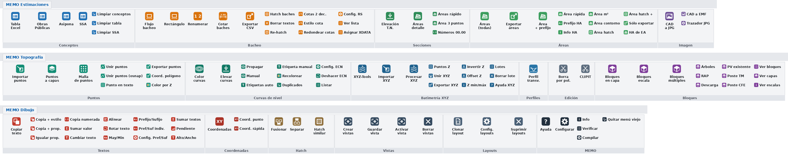

# MEMO SISTEMA para AutoCAD

Rutinas LISP para estimaciones, secciones, topografía y batimetría, con **instalación en un paso** y un **menú de fichas con iconos**.



## Instalar

1. Descarga [`MEMO_SISTEMA_bundle.zip`](MEMO_SISTEMA_bundle.zip) y descomprímelo.
2. Cierra AutoCAD.
3. Clic derecho en **`INSTALAR.bat`** → *Ejecutar como administrador*.
4. Abre AutoCAD: aparecen las fichas **MEMO Estimaciones**, **MEMO Topografía** y **MEMO Dibujo**.
5. **Sólo la primera vez**, si tenías el `Memo.cuix` anterior:
   - Escribe `MEMO_QUITAR_ANTERIOR`.
   - Quita los LISP viejos del *Conjunto de inicio* de `APPLOAD`.
6. En un dibujo nuevo, ejecuta `MEMO_VERIFICAR`: debe decir *Todo correcto*.

Para actualizar, vuelve a ejecutar `INSTALAR.bat`; tu configuración se conserva. Funciona con AutoCAD 2015–2026, Civil 3D y Map.

## Novedades 2.1

* **Las tablas COP, ASI y CSSA leen el portapapeles**: copias en Excel, ejecutas el comando y eliges el punto. Ya no hay que pegar y presionar Enter dos veces.
* **Comandos unificados**:
  * `MTABLA`: tablas; detecta el formato según las columnas copiadas.
  * `MAREA`: los 9 comandos de áreas en uno.
  * `MBACHEO`: flujo guiado Dibujar → Numerar → Cotar → Exportar.
* **`MEMO_CONFIG`**: anchos de columnas de las tablas, espesor de bacheo y uso del portapapeles.
* **`MEMO_VERIFICAR`** (prueba automática) y **`MEMO_COMPILAR`** (FAS compilados).
* **Comandos renombrados** para que tus alias del `acad.pgp` vuelvan a funcionar:

| Antes | Ahora | Tu alias |
|---|---|---|
| MP | *(eliminado, usa `MLL`)* | EMPALME |
| EL | `ELTN` | ELIPSE |
| RV | `RNB` | REVOLUCION |
| CC | `RSC` | CERRARCINTA |
| PV / TM | `IBPV` / `IBTM` | PTOVISTA / TILEMODE |
| CL | `CLO` | LINEACENTRO |
| LC | `LCO` | LINEACENTRO |
| CT | `CTB` | TXTC |
| CTT | `CTX` | ADMATRB |

## Documentos

* [ANALISIS_Y_PROPUESTAS.md](ANALISIS_Y_PROPUESTAS.md): errores encontrados en los LISP originales y cómo se resolvió cada propuesta.
* [LISTA_DE_PRUEBAS.md](LISTA_DE_PRUEBAS.md): qué probar y qué resultado esperar.

## Estructura

| Carpeta | Contenido |
|---|---|
| `originales/` | Los LISP tal como estaban (no se editan) |
| `fuente/` | Código nuevo: `MEMO_Lib.lsp` (biblioteca) y `MEMO_Unificados.lsp` |
| `herramientas/catalogo.py` | **Fuente de verdad**: archivos, parches, comandos, iconos, fichas y configuración |
| `herramientas/construir_bundle.py` | Genera el bundle, el CUIX, el cargador, los iconos, la lista de pruebas y el ZIP |
| `instaladores/` | `INSTALAR.bat`, `DESINSTALAR.bat` |
| `MEMO_SISTEMA.bundle/` | Resultado listo para AutoCAD (generado) |

## Modificar o agregar un LISP

```bash
pip install pillow
# 1. copia el .lsp a originales/MEMO_SISTEMA/<carpeta>/ (o escribe uno nuevo en fuente/)
# 2. edita herramientas/catalogo.py (ARCHIVOS, COMANDOS, FICHAS)
python herramientas/construir_bundle.py
python herramientas/vista_previa.py docs/vista_previa_fichas.png
```

El script se detiene si hay comandos duplicados, botones que apuntan a comandos inexistentes, comandos sin describir, paréntesis desbalanceados o XML inválido.
